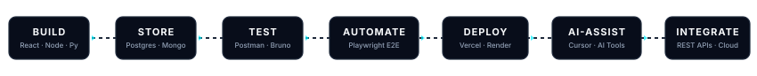

<!-- 1. Hero Identity Banner -->

 

<!-- 2. Animated Role Introduction (Centered Monospace Typing SVG) -->

  

<!-- 3. Navigation Buttons -->
&nbsp;&nbsp;
&nbsp;&nbsp;
&nbsp;&nbsp;

 

 

<!-- 4. About Section -->

  

 

  

    <b>Full-Stack Software Developer</b> focused on high-performance architectures 
    and clean, scalable systems. Currently building products as a 
    <b>Full-Stack Developer Intern at Godavari Wave Technologies</b>.
  

  

    Bridging complex backend systems with refined frontend experiences — 
    modern web &amp; mobile apps, robust REST APIs, and scalable AI-powered software.
  

 

 

<!-- 5. Experience Section -->

  

 

### Full-Stack Developer Intern
**Godavari Wave Technologies** · Rajahmundry, Andhra Pradesh, India · `● Active`

 

| Domain | Engineering Scope & Focus |
|:---|:---|
| **Frontend Architecture** | Modular, accessible user interfaces built with **React**, **TypeScript**, and **Tailwind CSS**. Emphasis on design systems, responsive performance, and state management. |
| **Backend & APIs** | Scalable, high-throughput REST APIs and microservices engineered with **Python**, **Django REST Framework**, and **Node.js / Express**. |
| **Data Layer & Reliability** | Relational and document data modeling in **PostgreSQL** and **MongoDB** with clean schema contracts and automated testing via **Postman** & **Playwright**. |

 

 

<!-- 6. Tech Stack Section -->

  

 

| Category | Technologies |
|:---|:---|
| **Frontend** | React · JavaScript · TypeScript · Tailwind CSS · Redux · Zustand |
| **Backend** | Python · Django REST Framework · Node.js · Express.js · REST APIs |
| **Mobile** | React Native |
| **Database** | MongoDB · PostgreSQL · Supabase · Firebase |
| **Cloud & DevOps** | Vercel · Render · Netlify · Railway · Cloudflare · Git · GitHub |
| **Tools & Testing** | Postman · Bruno · Playwright · VS Code · Cursor |

 

<!-- 7. Engineering Lifecycle Diagram -->

  

 

 

<!-- 8. Education & Languages Section -->

  

 

| Academic Degree | Languages |
|:---:|:---:|
| **Bachelor of Commerce (B.Com)** Andhra University (Online) *Expected 2029* | **Telugu** (Native) **English** (Professional) |

 

 

<!-- 9. GitHub Activity & Top Languages Section -->

  

 

  
  

 

<!-- 10. Contribution Snake Animation -->

  <picture>
    <source media="(prefers-color-scheme: dark)" srcset="https://raw.githubusercontent.com/lokesh-varma28/lokesh-varma28/output/github-snake-dark.svg">
    <source media="(prefers-color-scheme: light)" srcset="https://raw.githubusercontent.com/lokesh-varma28/lokesh-varma28/output/github-snake.svg">
    
  </picture>

 

 

<!-- 11. Connect Section -->

  

 

  

    <b>Open to Full-Stack Developer roles, technical collaborations, 
    and high-impact freelance projects.</b>
  

 

  &nbsp;&nbsp;
  &nbsp;&nbsp;
  &nbsp;&nbsp;
  

 

<!-- 12. Footer Wave -->

  

